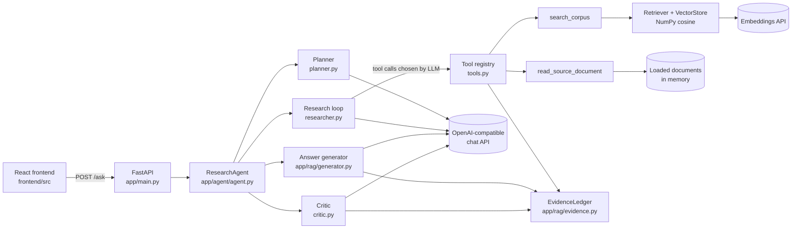
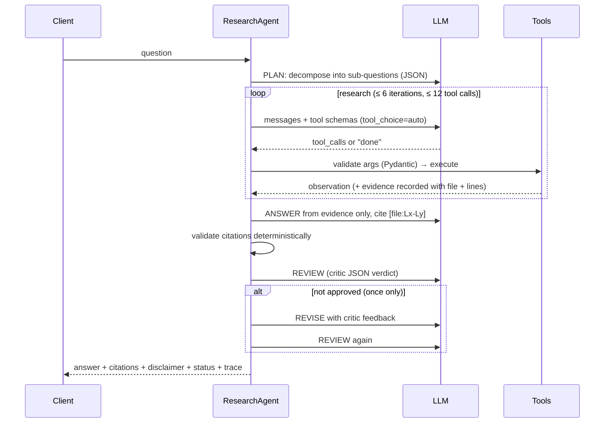

# Architecture

## Components



## Startup (index build)

```mermaid
sequenceDiagram
    participant U as uvicorn
    participant M as app/main.py
    participant I as retrieval/index.py
    U->>M: lifespan start
    M->>I: background thread: build_index()
    Note over M: /health already returns 200 (index_ready=false)
    I->>I: CorpusLoader.load_all() — 21 files, confined to corpus dir
    I->>I: MarkdownSectionChunker — 525 section-aware chunks with line ranges
    I->>I: Embedder.embed_chunks() — 9 batched embedding calls
    I->>I: VectorStore.add() — L2-normalised float32 matrix
    I-->>M: CorpusIndex ready (~15 s); /ask stops waiting
```

The index is rebuilt at every start instead of cached on disk: the corpus is small, and a cache could go stale
silently when the corpus, chunking parameters or embedding model change (the evaluator may use a different
embedding model). No credentials are needed at `docker build` time.

## Request flow (`POST /ask`)



## Key design decisions

| Decision | Why |
|---|---|
| Custom loop on the OpenAI SDK, no LangChain/LangGraph | ~150 lines; every step is visible and explainable; native function calling verified against the provider. |
| Planner separate from research loop | The plan is inspectable in the trace and steers the loop ("cover every sub-question"), without hardcoding a sequence. |
| Two tools: search + read | Search finds candidates; reading a whole section fixes chunk boundaries cutting lists in half (e.g. contraindication lists). |
| `read_source_document` serves in-memory documents by allow-listed filename | No path is ever built from model input → path traversal impossible by construction; plus a filename regex. |
| Evidence ledger with line ranges | One source of truth for context building, citations and the critic. |
| Deterministic citation validation + LLM critic | Code checks what code can check (file retrieved, line range is a retrieved passage); the LLM checks meaning (is the claim supported). Code can override an LLM "approve". |
| Corpus-coverage note per planned drug | Missing coverage is stated as such ("no dedicated document"), never as evidence that a drug/effect does not exist; also lets the critic recognise out-of-corpus questions. |
| Critic `irrelevant_citations` removed by code | Unrelated retrieved passages (top-k always returns something) can never be presented as support; an approved answer with no valid citation becomes `insufficient_evidence`. |
| Deterministic number/unit check | Cheap detector for altered thresholds/doses or changed units in cited sentences; it can veto an LLM "approve" but is never treated as proof of grounding. |
| Exact reads shown with per-line numbers | Lets the model cite precise lines that the validator can verify; guessed line numbers inside unnumbered chunks are rejected. |
| Max one revision | Bounded cost/latency; unresolved problems are shown to the user (`status: needs_review`) instead of looping. |
| No provider-specific JSON mode, no temperature | Works with any OpenAI-compatible model; JSON is parsed tolerantly. |
| Index built in a background thread | `/health` is 200 immediately; `/ask` waits (up to 180 s) for the index rather than failing. |

## Safety properties

- Answers only from retrieved evidence; missing evidence must be stated ("The provided documents do not state…").
- The disclaimer is appended by code, not by the model, so it is always present.
- Tool arguments from the LLM are validated (types, bounds, filename pattern) before execution; failures are
  returned to the LLM as observations, never raised to the user.
- Unknown tools, malformed JSON, duplicate calls and budget overruns are handled and logged.
- Unexpected exceptions and provider errors return generic messages; details stay in the server log.
- No CORS middleware: the UI is same-origin, so browsers on other origins cannot call the API.
- The container runs as an unprivileged user; no credentials are baked into the image.
